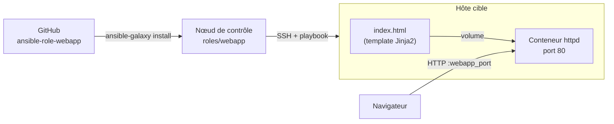

# Rôle Ansible : webapp

Rôle **Ansible** qui déploie un site **Apache (httpd)** dans un conteneur **Docker** et y publie une page générée par **Jinja2** : « Bienvenue sur -nom de l'hôte- ». Le rôle est **variabilisé**, **testé** et installable avec **ansible-galaxy**.


**Cours :** Bootcamp DevOps EAZYTraining — mini-projet Ansible
**Auteur :** Dakin Blair Noubouossie


## Sommaire

- [Description](#description)
- [Architecture](#architecture)
- [Prérequis](#prérequis)
- [Variables du rôle](#variables-du-rôle)
- [Dépendances](#dépendances)
- [Exemple de playbook](#exemple-de-playbook)
- [Tests](#tests)
- [Résultats](#résultats)
- [Difficultés rencontrées](#difficultés-rencontrées)
- [Contenu du dépôt](#contenu-du-dépôt)
- [Licence](#licence)
- [Auteur](#auteur)

## Description

Ce rôle transforme le playbook **webapp** des TP en un composant **réutilisable** par d'autres équipes et destiné à une **galaxy privée**. Il :

1. installe **Docker** et la bibliothèque Python **docker** ;
2. démarre Docker et l'active au démarrage ;
3. génère une page **`index.html`** à partir d'un template **Jinja2** ;
4. lance un conteneur **httpd** qui sert cette page grâce à un **montage de volume** ;
5. relance automatiquement le conteneur après un redémarrage (**`restart_policy: always`**).

Toutes les valeurs (image, version, port, message…) sont des **variables** modifiables sans toucher au code.

## Architecture



## Prérequis

- **Ansible ≥ 2.14** sur le nœud de contrôle.
- Collection **`community.docker`** (incluse dans le paquet `ansible` ; sinon : `ansible-galaxy collection install community.docker`).
- Hôte cible sous **Debian 12** ou **Ubuntu 22.04**, avec **Python 3**.
- Droits **root** sur la cible : le playbook doit utiliser **`become: true`**.
- Le **port** choisi (`webapp_port`) doit être libre et ouvert dans le pare-feu.

## Variables du rôle

Définies dans **`defaults/main.yml`** (priorité la plus faible, donc faciles à surcharger) :

| Variable | Valeur par défaut | Description |
|---|---|---|
| `webapp_container_name` | `webapp` | Nom du conteneur Docker |
| `webapp_image` | `httpd` | Image Docker utilisée |
| `webapp_image_tag` | `"2.4"` | Version de l'image |
| `webapp_port` | `80` | Port externe du site sur l'hôte |
| `webapp_html_dir` | `/opt/webapp` | Dossier de la page générée sur l'hôte |
| `webapp_message` | `Bienvenue sur` | Texte affiché avant le nom de l'hôte |

## Dépendances

**Aucune** dépendance vers d'autres rôles.

## Exemple de playbook

**1. Déclarer le rôle** dans `requirements.yml` :

```yaml
---
- src: https://github.com/Dakin-blair/ansible-role-webapp.git
  name: webapp
```

**2. L'installer** :

```bash
ansible-galaxy install -r requirements.yml -p roles
```

**3. L'utiliser** dans un playbook, en surchargeant les variables si besoin :

```yaml
---
- name: Deployer le site webapp
  hosts: webservers
  become: true
  roles:
    - role: webapp
      vars:
        webapp_port: 8080
        webapp_message: Bienvenue chez nous sur
```

## Tests

Le dossier **`tests/`** permet de tester le rôle en une commande :

- **`tests/inventory`** : `localhost` en connexion locale (aucune configuration nécessaire) ;
- **`tests/test.yml`** : applique le rôle, appelle le site avec **`uri`**, puis vérifie avec **`assert`** que la page contient `webapp_message`.

Test en local (depuis le dossier qui contient `roles/`) :

```bash
ANSIBLE_ROLES_PATH=roles ansible-playbook -i roles/webapp/tests/inventory roles/webapp/tests/test.yml
```

Test sur un autre hôte, avec un autre port :

```bash
ANSIBLE_ROLES_PATH=roles ansible-playbook -i <votre_inventaire> roles/webapp/tests/test.yml -e webapp_port=8080
```

Analyse des bonnes pratiques :

```bash
cd roles/webapp
ANSIBLE_ROLES_PATH=<chemin_absolu_vers_roles> ansible-lint
```

## Résultats

Validation réalisée sur **AWS EC2** (Debian 12, t3.micro), avec le rôle **installé depuis GitHub** :

| Test | Résultat |
|---|---|
| Installation `ansible-galaxy` | `webapp was installed successfully` |
| 1re exécution de `tests/test.yml` (port 8080) | `ok=8 changed=3 failed=0` |
| Vérification automatique (`assert`) | **Le site affiche bien : Bienvenue sur** |
| 2e exécution (idempotence) | `ok=8` **`changed=0`** `failed=0` |
| `curl http://<IP publique>:8080` | `<h1>Bienvenue sur ip-172-31-39-170</h1>` |
| `ansible-lint` | **Passed with production profile: 0 failure(s), 0 warning(s)** |

## Difficultés rencontrées

| Problème | Cause | Solution |
|---|---|---|
| `.travis.yml` absent après `ansible-galaxy role init` | ansible-core 2.14 ne génère plus ce fichier | Aucun impact : fichier facultatif |
| Port 80 déjà occupé sur l'hôte de test | Un conteneur WordPress utilisait le port 80 | Surcharge avec **`-e webapp_port=8080`**, sans modifier le rôle |
| `role-name[path]` avec ansible-lint | Le test appelait le rôle par son chemin (`{{ playbook_dir }}/..`) | Appel par son **nom** (`webapp`) |
| `the role 'webapp' was not found` | Ansible ne cherche pas les rôles dans le dossier d'installation | Variable d'environnement **`ANSIBLE_ROLES_PATH`** |

## Contenu du dépôt

| Fichier | Rôle |
|---|---|
| `defaults/main.yml` | Variables par défaut |
| `tasks/main.yml` | Tâches du rôle |
| `templates/index.html.j2` | Template de la page |
| `tests/inventory`, `tests/test.yml` | Playbook de tests |
| `meta/main.yml` | Métadonnées (galaxy) |
| `handlers/`, `vars/` | Générés par `ansible-galaxy` (non utilisés) |
| `images/` | Captures |
| `LICENSE` | Licence MIT |

## Licence

**MIT**

## Auteur

**Dakin Blair Noubouossie** — Bootcamp DevOps EAZYTraining
